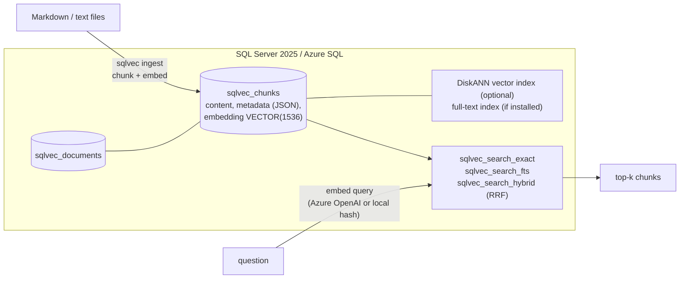

# sqlvec: native vector search in SQL Server 2025 and Azure SQL

[](https://github.com/sharath568/azure-data-sql-vectors/actions/workflows/ci.yml)
[](LICENSE)

SQL Server 2025 and Azure SQL now have a real `VECTOR` data type, a
`VECTOR_DISTANCE` function and a DiskANN vector index. So the question I
wanted to answer is simple: **if your data already lives in SQL Server, do
you still need a separate vector database?**

`sqlvec` is a small Python CLI plus a handful of plain T-SQL scripts that
try it for real: documents and chunks in ordinary tables, embeddings in a
`VECTOR(1536)` column, exact search, DiskANN search, full-text search, and
hybrid search (vector + keyword fused with RRF) in one stored procedure. It
runs offline against SQL Server 2025 Developer edition in Docker, or on the
Azure SQL Database free offer.

It's the third project in a series. The first two did the same thing for
PostgreSQL ([azure-data-pg-rag](https://github.com/sharath568/azure-data-pg-rag)),
so there's a [side-by-side with pgvector](#sql-server-next-to-pgvector) too.

## Why one database

I spent years as an Oracle DBA before moving into architecture work, and the
"just add a vector store" default always bothered me. You get a second copy
of your data, a sync pipeline that can fall behind, a second set of
permissions, backups that don't line up, and one more thing to patch and pay
for.

When the vectors sit in the same row as the text:

- a document and its embeddings are written in **one transaction**
- **backups, point-in-time restore, HA and replicas** cover the vectors too
- **row-level security, joins and WHERE clauses** apply to search results
- **keyword and vector search** run on the same rows, so hybrid search is
  one procedure call, not two services and glue code
- there's **one bill and one thing to monitor**

There are still good reasons for a dedicated vector database (see
[Limits](#limits)). But for a team that already runs SQL Server and has up to
a few million chunks, I'd start here.

## What's GA and what's preview (October 2026)

This moves fast. Here's where things stand according to Microsoft Learn as of
**2026-10-10**. Every line has a link in [docs/sources.md](docs/sources.md).

| feature | SQL Server 2025 | Azure SQL Database | Azure SQL MI |
|---|---|---|---|
| `VECTOR(n)` type, float32, up to 1,998 dims | GA | GA | GA ¹ |
| `VECTOR(n, float16)`, up to 3,996 dims | **preview** ² | GA | GA |
| `VECTOR_DISTANCE` (cosine / euclidean / dot), `VECTOR_NORM`, `VECTOR_NORMALIZE` | GA | GA | GA ¹ |
| `CREATE VECTOR INDEX ... TYPE = 'DiskANN'` + `VECTOR_SEARCH` | **preview** ² | GA | GA (Always-up-to-date policy); preview (SQL Server 2025 policy) ² |
| `CREATE EXTERNAL MODEL` + `AI_GENERATE_EMBEDDINGS` | GA (since May 2026) | GA | GA |
| `AI_GENERATE_CHUNKS` | available, status unclear ³ | available, status unclear ³ | not listed |
| Full-text search (`FREETEXTTABLE`) | separate install on Linux (`mssql-server-fts`) | built in | built in |

¹ MI needs the "SQL Server 2025" or "Always-up-to-date" update policy for vector features.
² Needs `ALTER DATABASE SCOPED CONFIGURATION SET PREVIEW_FEATURES = ON;` (sqlvec does this on SQL Server when you ask for the index).
³ I couldn't find a clear GA or preview statement for `AI_GENERATE_CHUNKS`. It may need `PREVIEW_FEATURES` on SQL Server 2025.

Limits that shape the design:

- **1,998 dimensions** for float32. `text-embedding-3-small` (1,536) fits;
  `text-embedding-3-large` (3,072) needs float16 or a smaller `dimensions`.
- `VECTOR_DISTANCE` is **always exact** and never uses an index. Microsoft
  suggests exact search up to roughly 50,000 vectors.
- DiskANN needs a **clustered primary key on an INT column** and **at least
  100 rows**. No `TRUNCATE` while it exists.
- **Is the table read-only after creating the index?** It depends on the
  index version. With the latest version (`build_parameters $.Version = 3`)
  no: normal DML works and WHERE filters run during the search. With the
  earlier version yes: the table is read-only and filters apply afterwards.
  Azure SQL Database has the new version. The docs don't say which SQL
  Server 2025 CU builds which, so `sqlvec doctor` shows you.
- Vector columns can't have `CHECK` or `DEFAULT` constraints, so vectors
  are validated in the client.
- Python drivers send vectors as **JSON text**; the engine converts.
  sqlvec binds `'[0.1,0.2,...]'` and casts it: `CAST(? AS VECTOR(1536))`.

## How it fits together



Embeddings come from Azure OpenAI `text-embedding-3-small`, or, for free
offline runs, a deterministic hashing embedder. On Azure SQL (and SQL Server
2025) the database can also call Azure OpenAI itself; see
[In-database embeddings](#in-database-embeddings-azure-sql--sql-server-2025).

## Local quickstart (free)

You need Docker (about 2 GB of RAM for the container) and Python 3.10+.
SQL Server 2025 Developer edition is free for development and testing.

```bash
git clone https://github.com/sharath568/azure-data-sql-vectors.git
cd azure-data-sql-vectors
docker compose up -d        # mcr.microsoft.com/mssql/server:2025-latest on localhost,1433
python -m venv .venv && source .venv/bin/activate
pip install -e ".[dev]"

sqlvec doctor                       # what does this engine support?
sqlvec init --create-database       # database, tables, procedures
sqlvec ingest examples/docs         # chunk + embed with the offline hash embedder
sqlvec search "how do I stop paying when the database is idle?" --mode exact
```

The Python driver is Microsoft's `mssql-python`. Its Linux wheels carry the
ODBC driver bits, so there's nothing else to install.

The official container image **doesn't include full-text search**, so
`hybrid` and `fts` aren't available there and a plain `sqlvec search`
falls back to exact vector search and tells you so. For hybrid locally, use
the full-text image (built from [docker/fts](docker/fts/Dockerfile), which
adds `mssql-server-fts`):

```bash
docker compose --profile fts up -d --build     # second server on localhost,1434
export SQLVEC_CONN="Server=localhost,1434;Database=sqlvec;UID=sa;PWD=Sqlvec_Local_Dev_2026!;Encrypt=yes;TrustServerCertificate=yes"
sqlvec init --create-database && sqlvec ingest examples/docs
sqlvec search "error 1205 deadlock"            # hybrid is the default mode
sqlvec search "GP_S_Gen5_2" --mode fts
```

The DiskANN index needs at least 100 chunks, and the sample docs are fewer
than that, so try it with the benchmark, or with your own docs:

```bash
sqlvec ingest ~/my-notes
sqlvec index                # turns on PREVIEW_FEATURES on SQL Server 2025, then CREATE VECTOR INDEX
sqlvec doctor               # shows the index version (3 = DML-capable)
sqlvec search "..." --mode ann
```

A few more things to try:

```bash
sqlvec ingest examples/docs --meta team=platform --force
sqlvec search "auto-pause" --mode exact --filter team=platform
sqlvec search "DiskANN" --json
sqlvec compare-pg            # T-SQL next to pgvector, operation by operation
sqlvec cost                  # will my demo fit in the Azure SQL free offer?
sqlvec bench -n 5000 --dims 384
```

The hash embedder only knows which words overlap, not what they mean. It
exists so everything runs without an API key. For real retrieval quality,
use Azure OpenAI (`SQLVEC_EMBED_PROVIDER=azure`, see
[.env.example](.env.example)).

## Azure quickstart (free offer)

The Azure SQL Database free offer gives you, per database and per month,
100,000 vCore-seconds of serverless compute and 32 GB of storage, for up to
10 databases per subscription, for the life of the subscription. With the
"auto-pause" setting the database simply pauses when the allowance runs out.
It can't bill you. That's what [infra/main.bicep](infra/main.bicep) sets up
(`useFreeLimit: true`, `freeLimitExhaustionBehavior: 'AutoPause'`,
GP_S_Gen5_2 serverless), plus a firewall rule for your IP and a budget
alert. Azure OpenAI is optional and pay per token.

```bash
az login
BUDGET_EMAIL=you@example.com ./scripts/up.sh       # add DEPLOY_OPENAI=true for embeddings
cp .env.azure .env

sqlvec doctor        # Azure SQL Database: DiskANN is GA, full-text built in
sqlvec init
sqlvec ingest examples/docs
sqlvec search "how do I keep the database free?"

./scripts/down.sh    # delete the resource group when you're done
```

Full-text is built in on Azure SQL Database, so hybrid search works out of
the box there, and the DiskANN index doesn't need any preview flag.

### Where the free vCore-seconds go

The thing that surprised me: serverless keeps billing a floor while the
database sits idle waiting to auto-pause, and that floor is set by memory,
not vCores. For GP_S_Gen5_2 with 0.5 min vCores it's 2.05 GB / 3 = 0.683
vCores. `sqlvec cost` does the maths:

```text
$ sqlvec cost
Usage: 20 sessions/month x 30 min active at ~1 vCores, auto-pause delay 60 min, GP_S_Gen5_2 (min 0.5 vCores).

| line | vCore-seconds |
|---|---:|
| active (billed at 1 vCores) | 36,000 |
| idle until auto-pause (floor 0.6833 vCores) | 49,200 |
| **total** | **85,200** |
| free allowance | 100,000 |

That's 85.2% of the monthly allowance; about 23 sessions like this fit in it.
...
| delay (min) | vCore-seconds | % of free | sessions that fit |
|---:|---:|---:|---:|
| 15 | 48,300 | 48.3% | 41 |
| 30 | 60,600 | 60.6% | 33 |
| 60 | 85,200 | 85.2% | 23 |
```

So the idle tail costs more than the work, and the cheapest change you can
make is the auto-pause delay (15 minutes is the minimum). These are
estimates from Microsoft's published billing formula, not measurements, and
the dollar figures are labelled "verify" for a reason. More on the cost
guardrails in [infra/README.md](infra/README.md).

### In-database embeddings (Azure SQL / SQL Server 2025)

[`sql/azure/in_db_embeddings.sql`](sql/azure/in_db_embeddings.sql) creates an
external model pointing at your Azure OpenAI deployment, then two procedures:

- `sqlvec_search_hybrid_text @query_text` embeds the question **inside the
  database** with `AI_GENERATE_EMBEDDINGS` and runs the hybrid search: one
  round trip, no embedding code in the app.
- `sqlvec_ingest_text @source, @title, @text` chunks with
  `AI_GENERATE_CHUNKS` and embeds each chunk with `AI_GENERATE_EMBEDDINGS`,
  all in T-SQL.

```bash
sqlcmd -S <server>.database.windows.net -d sqlvec -U sqlvecadmin -P '<pwd>' \
  -v endpoint="https://<name>.openai.azure.com/" api_key="<key>" \
     deployment="text-embedding-3-small" dims="1536" master_key_password="<strong pwd>" \
  -i sql/azure/in_db_embeddings.sql
```

sqlvec never runs this script for you. It stores an API key in a database
scoped credential, which is fine for a demo; use a managed identity for
anything real. I ran it end to end on Azure SQL Database on 2026-10-11
(see [docs/azure-run.md](docs/azure-run.md)): both procedures work, and the
run caught one bug (Azure SQL refuses to compile `RECONFIGURE`, even in a
branch that doesn't run there), now fixed. With `sqlcmd` missing, nl2sql's
`scripts/run_tsql.py` or any batch runner that splits on `GO` will do.

## How hybrid search works

Vector search is good at meaning: "stop paying when idle" finds a passage
about auto-pause. Keyword search is good at exact tokens: error 1205,
`MAXDOP`, `GP_S_Gen5_2`. Hybrid search runs both and merges them with
**Reciprocal Rank Fusion**:

```text
score(chunk) = sum over lists of  1 / (60 + rank in that list)
```

A chunk ranked 1st by vectors and 3rd by keywords scores
`1/61 + 1/63 = 0.0323`. A chunk only the vector side found, at rank 1,
scores `1/61 = 0.0164`. RRF only looks at ranks, so a cosine distance and a
full-text `RANK` never have to be put on the same scale.

It's one stored procedure,
[`sqlvec_search_hybrid`](sql/004_hybrid_search.sql):

1. **Vector candidates:** the best 50 by `VECTOR_DISTANCE('cosine', ...)`,
   numbered with `ROW_NUMBER()`.
2. **Keyword candidates:** the best 50 from `FREETEXTTABLE`, which takes a
   plain question, matches any of its words, and applies stemming and the
   stoplist. (The Postgres version of this project taught me that "all
   words must match" makes the keyword side come back empty for real
   questions.)
3. **Fuse:** `FULL OUTER JOIN` the two lists and add up `1 / (60 + rank)`,
   in `FLOAT` so it matches the Python reference exactly.
4. **Filter:** both sides apply the same JSON metadata filter
   (`--filter team=platform`), via `OPENJSON` so no JSON path is ever built
   from user input.

The vector side uses exact search, which is the right call below roughly
50k chunks. A plain Python version of RRF lives in
[`src/sqlvec/rrf.py`](src/sqlvec/rrf.py), and an integration test checks
the procedure returns the same ids, ranks and scores.

## SQL Server next to pgvector

If you know one, here's the other. Run `sqlvec compare-pg` for the full list
in your terminal; [docs/compare-pgvector.md](docs/compare-pgvector.md) has it
with notes.

| operation | SQL Server 2025 / Azure SQL | PostgreSQL + pgvector |
|---|---|---|
| column | `embedding VECTOR(1536)` | `embedding vector(1536)` |
| cosine distance | `VECTOR_DISTANCE('cosine', embedding, @qv)` | `embedding <=> :qv` |
| exact top-k | `SELECT TOP (10) ... ORDER BY VECTOR_DISTANCE(...)` | `ORDER BY embedding <=> :qv LIMIT 10` |
| ANN index | `CREATE VECTOR INDEX ... WITH (METRIC = 'cosine', TYPE = 'DiskANN')` | `CREATE INDEX ... USING hnsw (embedding vector_cosine_ops)` |
| ANN query | `SELECT TOP (10) WITH APPROXIMATE ... FROM VECTOR_SEARCH(...)` | same SQL as exact; the planner picks the index |
| ANN knob | none | `SET hnsw.ef_search = 100` |
| keyword search | `FREETEXTTABLE(chunks, content, @q)` | `to_tsvector(...) @@ plainto_tsquery(:q)` |
| in-DB embeddings | `AI_GENERATE_EMBEDDINGS(@t USE MODEL m)` | `azure_openai.create_embeddings(...)` (Azure only) |

The differences that matter most to me: SQL Server makes approximate search
**explicit** in the query, has **one index type and no tuning knob**, and the
index is still **preview on boxed SQL Server 2025** while GA on Azure SQL.
pgvector has more knobs, a bigger indexable dimension range with `halfvec`,
and `jsonb @>` filters that can use a GIN index.

## Benchmark

`sqlvec bench` generates clustered, unit-length float32 vectors, computes
the exact top-10 in NumPy as ground truth, loads the vectors (JSON batches
unpacked with `OPENJSON`), and measures:

- load time
- recall@10 and p50 / p95 latency for **exact** `VECTOR_DISTANCE`
- DiskANN **index build time**, then recall@10 and p50 / p95 for
  `VECTOR_SEARCH` (skipped, with the engine's reason, if unsupported)
- table size before and after the index with `sp_spaceused`

It writes Markdown and JSON (`--out`).

**I don't have measured numbers to show you yet.** The sandbox I built this
in couldn't reach the Microsoft container registry or package repository,
so I couldn't run SQL Server there, and I'm not going to put made-up
numbers in a README. CI runs a 5k x 384 benchmark against the
`mssql/server:2025-latest` container on every push: see the
`bench-ci-5k-384` artifact and the job summary of the latest
[CI run](https://github.com/sharath568/azure-data-sql-vectors/actions/workflows/ci.yml).
Those are shared GitHub runners, so read them as "works, roughly this
fast", not as a performance claim. An Azure SQL run is next; results will
go in [docs/bench](docs/bench/README.md).

## Commands

| command | what it does |
|---|---|
| `sqlvec doctor` | Engine, edition, VECTOR support, full-text, PREVIEW_FEATURES, vector index version. |
| `sqlvec init [--create-database] [--ann]` | Tables, full-text index (if installed), search procedures. Idempotent. |
| `sqlvec index [--drop]` | Create or drop the DiskANN index (needs >= 100 chunks). |
| `sqlvec ingest PATH [--meta k=v] [--force] [--prune]` | Chunk, embed and store `.md` / `.txt`. Unchanged files are skipped by content hash. |
| `sqlvec search "q" [--mode exact\|ann\|fts\|hybrid] [-k 5] [--filter k=v] [--json]` | Search. Default is hybrid, falling back to exact (with a note) when full-text isn't available. |
| `sqlvec bench [-n 5000] [--dims 384] [--out path]` | Exact vs DiskANN: recall@10, p50/p95, load and build time, size. |
| `sqlvec cost [--sessions N] [--active-minutes M] [--autopause-delay D] ...` | Azure SQL free offer vCore-seconds estimate. |
| `sqlvec compare-pg [--format text\|markdown]` | Every operation in T-SQL next to pgvector. |
| `sqlvec config` | Effective settings, password masked. |
| `sqlvec drop --yes` | Remove every sqlvec object. |

Settings come from environment variables or a `.env` file; see
[.env.example](.env.example).

## Project layout

```text
sql/                    schema, full-text, exact / fts / hybrid procedures, DiskANN index
sql/queries/            VECTOR_SEARCH (new and legacy syntax) and exact bench queries
sql/azure/              external model + AI_GENERATE_EMBEDDINGS / AI_GENERATE_CHUNKS (optional)
src/sqlvec/             CLI, db access, chunking, embeddings, RRF reference, bench, cost, compare
tests/unit/             no database needed (190 tests)
tests/integration/      need SQLVEC_TEST_CONN (SQL Server 2025 or Azure SQL)
infra/                  main.bicep (free offer) + cost notes
scripts/                up.sh, down.sh, wait_for_sql.py
docker/fts/             SQL Server 2025 + full-text search image
examples/docs/          small sample corpus
docs/                   sources (with dates), pgvector comparison, benchmark results
```

## Running the tests

```bash
pytest -m "not integration"                    # unit tests, no database
docker compose up -d
export SQLVEC_TEST_CONN="$(grep '^# SQLVEC_TEST_CONN=' .env.example | cut -d= -f2-)"
pytest -m integration -rs                      # creates and uses the sqlvec_test database
ruff check . && ruff format --check .
```

Preview and optional features are probed first. If the engine says no
(DiskANN without `PREVIEW_FEATURES`, full-text not installed), those tests
**skip with the engine's own message** rather than fail, so a green run
never pretends a feature works. `-rs` prints the reasons.

The unit tests also check the rule this project lives by: **user input
never becomes SQL text**. Questions, vectors, filters and k always travel as
parameters; the only values written into SQL are validated integers and
sqlvec's own table names.

## Limits

Being upfront about what this is and isn't:

- **It's a reference implementation, not a framework.** Markdown and text
  only, a simple character-based chunker, no answer generation (pair it
  with any LLM).
- **Not run end to end by me yet.** Unit tests (190) pass; the integration
  tests and benchmark run in CI against the SQL Server 2025 container. The
  Bicep template builds and lints with Bicep 0.48.1 but hasn't been
  deployed from this repo, and the in-database embeddings script hasn't
  been run.
- **The hash embedder isn't semantic.** It's for free demos and tests.
- **float32 only, up to 1,998 dims.** No float16 support yet.
- **Metadata filters are a per-row JSON check.** Fine for thousands of
  chunks; for anything bigger, promote hot filter keys to real (or
  computed) columns and index them.
- **Full-text is English only** (`LANGUAGE 1033`) and needs
  `mssql-server-fts` on Linux.
- **SQL auth and API keys** for the demo. Use Microsoft Entra ID, private
  endpoints and managed identity for anything real.
- **When a separate vector database makes sense:** hundreds of millions of
  vectors, very high vector-only query rates you want to scale apart from
  your transactional database, needs DiskANN can't meet (other index types,
  tuning knobs, more dimensions), or a team that doesn't run SQL Server at
  all. Even then, measure first.

## Contributing

Issues and PRs are welcome, especially benchmark runs on Azure SQL Database
and confirmation of which SQL Server 2025 CU builds which DiskANN index
version. See [CONTRIBUTING.md](CONTRIBUTING.md).

## License

[MIT](LICENSE) (c) 2026 Sharath Chandra Kampili
